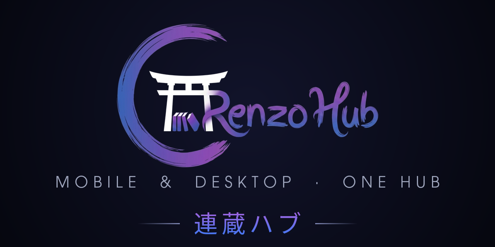

<p align="center">
  
</p>

# Renzo Hub

The one native client for the Renzo ecosystem: **Renzo** (anime) and
**Renzo Shiori** (manga), in a single app for Android phones and tablets,
Android TV and Windows.

Renzo Hub connects to your own self-hosted servers. Each half has its own
server address and account; a launch picker chooses a half when the app
starts, and "Switch to …" in either half's menu moves to the other without
restarting.

Renzo Hub is the only client: the earlier standalone Renzo and Renzo Shiori
apps were retired and their sources removed.

**[Download the latest release](https://github.com/Levitate0/Renzo-Hub/releases/latest)** ·
**[Documentation wiki](https://github.com/Levitate0/Renzo-Hub/wiki)**

## Platforms

| Platform | Download | Notes |
|---|---|---|
| Android phone / tablet | `RenzoHub-<version>.apk` | Android 7.0 (API 24) or newer |
| Android TV | the same APK | sign in with a code instead of typing a password |
| Windows (64-bit) | `RenzoHub-Setup-<version>.exe` | per-user install, no admin rights; Java runtime included |

Each release also carries a `SHA256SUMS` file.

## Features

**Manga (Renzo Shiori)**

- Library with filters, categories and collections (drag to reorder), 18+
  filter, and Add / Request Series across your server's sources.
- Reader with paged (left-to-right, right-to-left, double page) and
  continuous modes (webtoon, long strip, vertical), per-series mode memory,
  page scale and fit, rebindable keyboard shortcuts, and slicing for very
  tall pages so they stay sharp.
- Clear chapter breaks in continuous reading, with an optional stop for
  fast flicks so you don't scroll past the end of a chapter.
- **Switch source** while reading a streamed chapter, and paid-chapter
  handling: unlock on the source, check purchases, and optional
  **auto-buy** through your site logins.
- Queue (retry all, clear failed, clear completed), Updates, History, Browse
  with tag filters, and server Status.
- Sources: install and manage extensions, default priority order, a
  **Health** tab for failing sources, and **Migrate** to move series to
  other sources.
- Trackers (AniList, MyAnimeList, Kitsu, MangaDex, ComicVine), site logins,
  device sign-ins, and user administration for owners and admins.

**Anime (Renzo)**

- Discover, Library, Updates, History, search, and title pages with
  franchise season strips and episode air dates.
- Player: Media3 on Android and TV; on Windows a built-in libVLC player
  (through the project's own LGPL-clean binding, not vlcj) with subtitles,
  audio-track choice and playback speed, or an external player (mpv / VLC).
- Resume from where you stopped, up-next countdown with **Autoplay** and
  **Skip countdown** settings.
- AniList / MyAnimeList tracking with status, progress and score.

**Both halves**

- **Offline:** save manga chapters and anime episodes to the device and use
  them without a connection.
- **New-release notifications** on Android phones and tablets, per series or
  for a whole library.
- **TV mode and TV pairing:** a remote-friendly layout scaled to the TV, and
  sign-in by approving a code from another device.
- Sign-in with remember-me, password reset and invite links (paste the link
  from the email into the app), theme presets and accent colours.

See the **[Features](https://github.com/Levitate0/Renzo-Hub/wiki/Features)**
page for the full user guide.

## Install

**Android (phone, tablet, TV):** download `RenzoHub-<version>.apk` from the
[Releases page](https://github.com/Levitate0/Renzo-Hub/releases), open it and
allow installing from that source if asked. On a TV, sideload the same APK
(for example with a downloader app or `adb install`).

**Windows:** download and run `RenzoHub-Setup-<version>.exe`. It installs for
the current user without admin rights and adds Start menu and desktop
shortcuts. Run a newer installer to update.

**First run:** pick *Anime* or *Manga*, enter that server's address (for
example `192.168.1.10:8787` — the app tries `https://` then `http://`), and
sign in with your account on that server. Repeat for the other half if you use
both. A brand-new server needs its owner account created from its web UI
first.

Details, checksums and upgrade notes:
**[Installing](https://github.com/Levitate0/Renzo-Hub/wiki/Installing)**.

## Building

Requires JDK 21 and an Android SDK with platform 36.

```bash
./gradlew :app:assembleRelease                  # Android APK (all form factors)
./gradlew :feature-shiori:compileKotlinDesktop  # fastest compile check
./gradlew :hub-desktop:run                      # run the desktop app
tools/build-windows-exe.sh                      # Windows installer (cross-built on Linux)
```

Build the APK before any desktop target in a fresh Gradle cache — see
**[Building](https://github.com/Levitate0/Renzo-Hub/wiki/Building)** for the
reason, signing via an untracked `key.properties`, and the installer's
requirements. Releases are cut as described in
**[Releasing](https://github.com/Levitate0/Renzo-Hub/wiki/Releasing)**.

## Repository layout

```
app/            Android app: launch picker, manifest, notifications, signing
hub-desktop/    Windows / desktop entry point and installer scripts
core/           shared: request signing, prefs, images, offline downloads,
                TV pairing, release alerts
feature-shiori/ manga half (Renzo Shiori)
feature-renzo/  anime half (Renzo), including both video players
docs/           parity ledger, parity gaps, design and handoff notes, brand art
tools/          Windows installer build, store-screenshot helpers
```

`:core`, `:feature-shiori` and `:feature-renzo` are Kotlin Multiplatform
modules with an Android and a desktop target; nearly all UI code is shared.
The two feature modules never depend on each other. See
**[Architecture](https://github.com/Levitate0/Renzo-Hub/wiki/Architecture)**.

## Parity with the web

Renzo Hub is one of three surfaces — the Renzo Shiori web UI, the Renzo web
UI and the Hub — kept in step in both directions. Native screens are
transliterated from the web component source rather than approximated.

- [`docs/UI_PARITY.md`](docs/UI_PARITY.md) — the rule and the screen map.
- [`docs/PARITY-GAPS.md`](docs/PARITY-GAPS.md) — open gaps, and differences
  that are deliberate.

An index of everything in `docs/`, marking which notes are historical, is on
the **[Project Notes](https://github.com/Levitate0/Renzo-Hub/wiki/Project-Notes)**
wiki page.

## Brand assets

`docs/brand/` holds the source artwork:

| File | Size | Use |
|---|---|---|
| `renzo-hub-banner.png` | 1280×640 | README header and the GitHub social preview |
| `renzo-hub-wordmark.png` | 1236×702 | transparent lockup — login and splash banners |
| `renzo-hub-icon.png` | 1024×1024 | transparent mark — app and launcher icon source |
